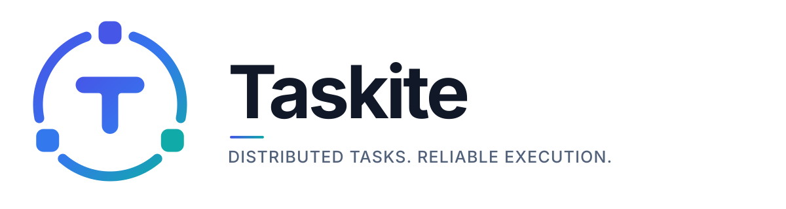
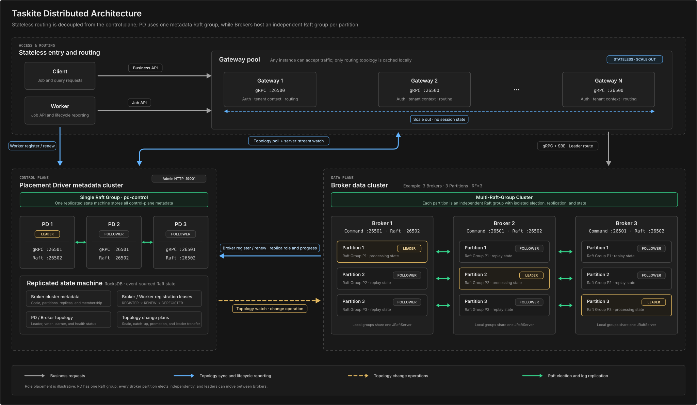

# Taskite

<p align="right"><strong>English</strong> | <a href="README.zh-CN.md">简体中文</a></p>



<h2 align="center">Make jobs work.</h2>

<p align="center">
  A distributed job scheduling engine for durable, fault-tolerant task execution at scale.
</p>

<p align="center">
  <a href="https://github.com/taskite-io/taskite">
    
  </a>
  <a href="https://github.com/taskite-io/taskite/blob/main/LICENSE">
    
  </a>
  
  
</p>

Taskite manages ordinary and scheduled jobs with reliable execution at scale.
It provides durable job execution, Multi-Raft replication, horizontal scaling,
failure recovery, and multi-tenant routing.

- Website: [taskite.io](https://taskite.io)
- Repository: [github.com/taskite-io/taskite](https://github.com/taskite-io/taskite)

## Why Taskite

- **Ordinary and scheduled jobs** - Create jobs directly through gRPC and manage reusable
  job subscriptions and independent timers with ISO8601 durations/cycles and six-field cron expressions.
- **Language-agnostic client model** - Build clients and workers in any language supported by
  Protocol Buffers and gRPC.
- **Message-driven architecture** - Record job commands and events in an append-only,
  replicated log to preserve ordering and make execution durable and recoverable.
- **Horizontal scalability** - Scale Brokers and partitions independently, distribute processing
  across the cluster, and handle large job volumes without an external relational database.
- **High availability and fault tolerance** - Keep processing available through node failures,
  leader changes, and transient network disruption.

## Architecture

Gateway is stateless and scales horizontally while routing requests with topology maintained by
the Placement Driver. The Placement Driver runs a single Raft group that stores Broker metadata,
Broker and Worker registrations and leases, and cluster topology. Brokers form the data plane,
where each business partition is an independent Raft group with its own leader and replicated
state machine. Job subscriptions travel through Gateway → Placement Driver → Broker → partition.
The Placement Driver coordinates subscription distribution, mirrors, acknowledgements and
scheduled firings. Workers activate and complete jobs using their registered leases.



## Current Scope

Taskite is under active development and currently builds as `0.1.0-SNAPSHOT`.

The engine supports job lifecycle management, variables, incidents, and API-created schedules.
APIs and storage compatibility may continue to evolve before the first stable release.

## Get Started

Build the project and run its verification suite:

```bash
git clone https://github.com/taskite-io/taskite.git
cd taskite
mvn clean verify
```

Run one of the packaged server roles:

```bash
java -jar dist/target/taskite-distribution-0.1.0-SNAPSHOT.jar \
  <placement-driver|broker|gateway> --key=value
```

Helper scripts for launching a local cluster and testing Broker scale-up are available in
[`scripts/`](https://github.com/taskite-io/taskite/tree/main/scripts).

## Documentation and Community

- [Website](https://taskite.io)
- [Source code](https://github.com/taskite-io/taskite)
- [Contributing guide](https://github.com/taskite-io/taskite/blob/main/CONTRIBUTING.md)
- [Code of Conduct](https://github.com/taskite-io/taskite/blob/main/CODE_OF_CONDUCT.md)
- [Issue tracker](https://github.com/taskite-io/taskite/issues)

## Licensing

Taskite is source-available under the
[Taskite Community License 1.0](https://github.com/taskite-io/taskite/blob/main/LICENSE).
The license permits non-commercial use and limited commercial evaluation. Commercial production
use, hosted or managed offerings, and other commercial use require a separate written license.
It is not an OSI-approved open source license.

See the [commercial licensing guide](https://github.com/taskite-io/taskite/blob/main/COMMERCIAL-LICENSING.md)
or contact `lz19960321lz@gmail.com`.
