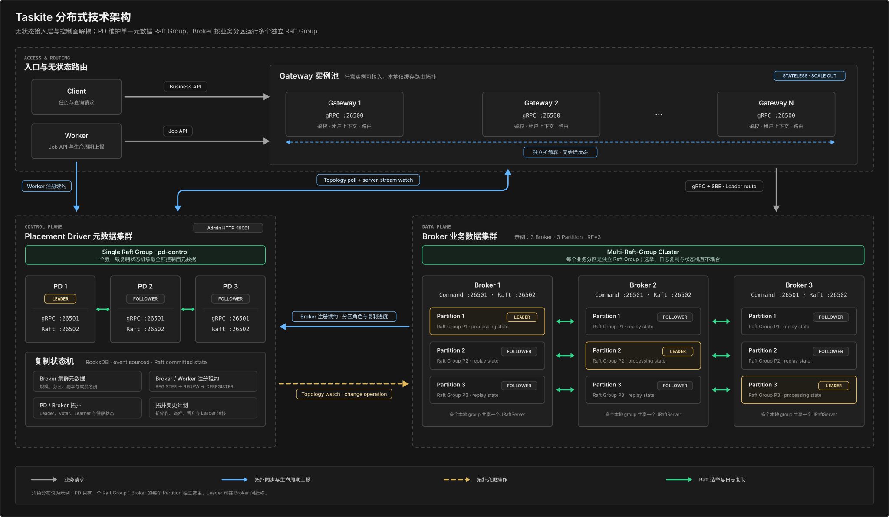

# Taskite

<p align="right"><a href="README.md">English</a> | <strong>简体中文</strong></p>


<h2 align="center">让任务可靠执行。</h2>

<p align="center">
  面向大规模持久化、容错任务执行的分布式任务调度引擎。
</p>

<p align="center">
  <a href="https://github.com/taskite-io/taskite">
    
  </a>
  <a href="https://github.com/taskite-io/taskite/blob/main/LICENSE">
    
  </a>
  
  
</p>

Taskite 管理普通任务和定时任务，支持大规模可靠执行，提供持久化任务执行、
Multi-Raft 复制、水平扩展、故障恢复和多租户路由能力。

- 网站：[taskite.io](https://taskite.io)
- 代码仓库：[github.com/taskite-io/taskite](https://github.com/taskite-io/taskite)

## 为什么选择 Taskite

- **普通任务与定时任务** - 通过 gRPC 直接创建任务，并使用 ISO8601 时长和周期表达式、
  六字段 cron 表达式管理可复用的任务订阅和独立定时器。
- **多语言客户端模型** - 使用 Protocol Buffers 和 gRPC 支持的任意语言构建客户端和
  Worker。
- **消息驱动架构** - 将任务命令和事件写入只追加的复制日志，保留顺序并确保执行过程
  持久、可恢复。
- **水平扩展** - Broker 节点和分区可以独立扩展，在集群内分散处理负载，无需依赖外部
  关系型数据库即可处理大规模任务。
- **高可用与容错** - 在节点故障、Leader 切换和临时网络异常期间维持处理能力。

## 架构

Gateway 是无状态组件，可以水平扩展，并使用 Placement Driver 维护的拓扑进行请求路由。
Placement Driver 运行单个 Raft Group，保存 Broker 元数据、Broker/Worker 注册与租约以及
集群拓扑。Broker 构成数据面，每个业务分区都是独立的 Raft Group，拥有自己的 Leader 和
复制状态机。任务订阅经 Gateway → Placement Driver → Broker → 分区分发。
Placement Driver 协调订阅分发、镜像、确认和定时触发。Worker 使用注册时获得的租约
激活和完成任务。



## 当前范围

Taskite 正在积极开发中，当前构建版本为 `0.1.0-SNAPSHOT`。

引擎支持任务生命周期管理、变量、故障事件（Incident）以及通过 API 创建的定时计划。
在首个稳定版本发布前，API 和存储兼容性可能继续演进。

## 快速开始

构建项目并运行验证套件：

```bash
git clone https://github.com/taskite-io/taskite.git
cd taskite
mvn clean verify
```

运行打包后的服务端角色之一：

```bash
java -jar dist/target/taskite-distribution-0.1.0-SNAPSHOT.jar \
  <placement-driver|broker|gateway> --key=value
```

本地集群启动和 Broker 扩容测试的辅助脚本位于
[`scripts/`](https://github.com/taskite-io/taskite/tree/main/scripts)。

## 文档和社区支持

- [网站](https://taskite.io)
- [源代码](https://github.com/taskite-io/taskite)
- [贡献指南](https://github.com/taskite-io/taskite/blob/main/CONTRIBUTING.md)
- [行为准则](https://github.com/taskite-io/taskite/blob/main/CODE_OF_CONDUCT.md)
- [问题跟踪](https://github.com/taskite-io/taskite/issues)

## 许可证

Taskite 根据
[Taskite Community License 1.0](https://github.com/taskite-io/taskite/blob/main/LICENSE)
以源代码可用的形式发布。该许可证允许非商业用途和有限的商业评估。商业生产用途、托管或
代管服务以及其他商业用途需要另行取得书面许可。该许可证并非 OSI 批准的开源许可证。

请参阅[商业许可指南](https://github.com/taskite-io/taskite/blob/main/COMMERCIAL-LICENSING.md)，
或联系 `lz19960321lz@gmail.com`。
