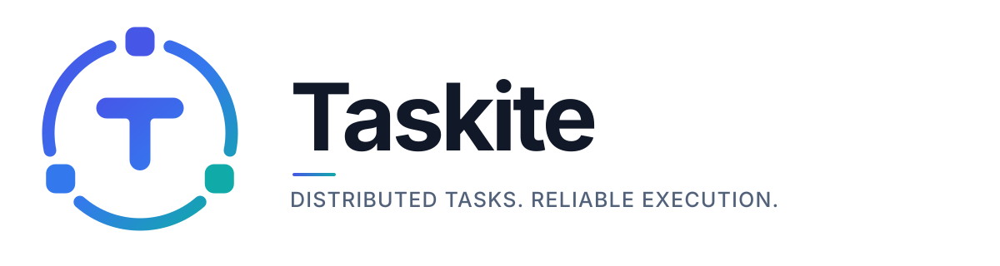
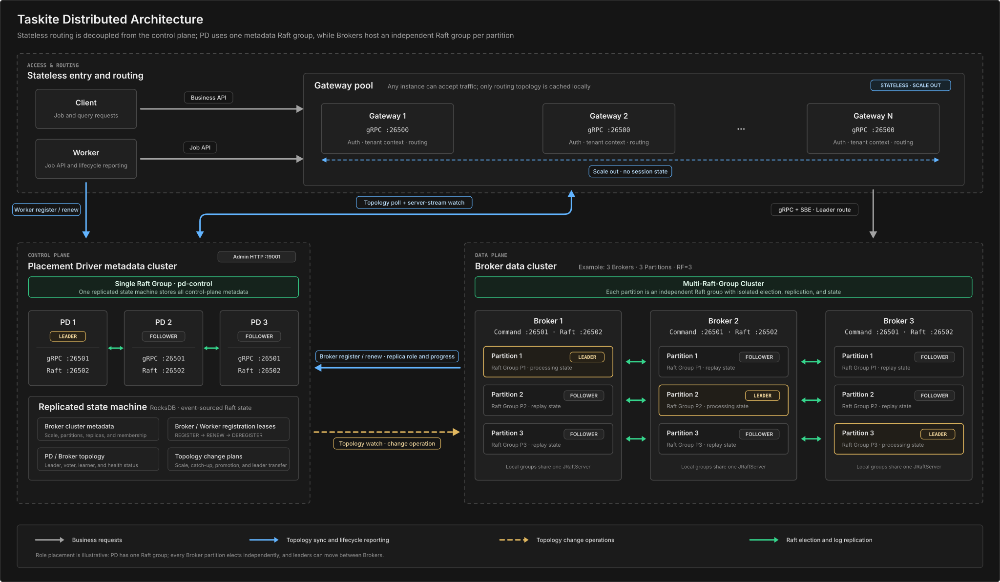

# Taskite

<p align="right"><strong>English</strong> | <a href="README.zh-CN.md">简体中文</a></p>



<h2 align="center">Make jobs work.</h2>

<p align="center">
  A distributed job scheduling engine for durable, fault-tolerant task execution at scale.
</p>

<p align="center">
  <a href="https://github.com/taskite-io/taskite">
    
  </a>
  <a href="LICENSE">
    
  </a>
  
  
</p>

Taskite manages ordinary and scheduled jobs with reliable execution at scale.
It provides durable job execution, Multi-Raft replication, horizontal scaling,
failure recovery, and multi-tenant routing.

- Website: [taskite.io](https://taskite.io)
- Repository: [github.com/taskite-io/taskite](https://github.com/taskite-io/taskite)
- Java namespace: `io.taskite`
- Maven group: `io.taskite`
- Server artifact: `io.taskite:taskite-distribution`
- Brand guide: [taskite-brand.md](taskite/taskite-brand.md)

## Why Taskite

- **Ordinary and scheduled jobs** - Create jobs directly through gRPC and manage reusable
  job subscriptions and independent timers with ISO8601 durations/cycles and six-field cron expressions.
- **Language-agnostic client model** - Build clients and workers in any language supported by
  Protocol Buffers and gRPC.
- **Message-driven architecture** - Record job commands and events in an append-only,
  replicated log to preserve ordering and make execution durable and recoverable.
- **Horizontal scalability** - Scale Brokers and partitions independently, distribute processing
  across the cluster, and handle large job volumes without an external relational database.
- **High availability and fault tolerance** - Keep processing available through node failures,
  leader changes, and transient network disruption.

## Architecture

Gateway is stateless and scales horizontally while routing requests with topology maintained by
the Placement Driver. The Placement Driver runs a single Raft group that stores Broker metadata,
Broker and Worker registrations and leases, and cluster topology. Brokers form the data plane,
where each business partition is an independent Raft group with its own leader and replicated
state machine. Job subscriptions travel through Gateway → Placement Driver → Broker → partition.
The Placement Driver coordinates subscription distribution, mirrors, acknowledgements and
scheduled firings. Workers activate and complete jobs using their registered leases.



## Current Scope

Taskite is under active development and currently builds as `0.1.0-SNAPSHOT`.

The engine supports job lifecycle management, variables, incidents, and API-created schedules.
APIs and storage compatibility may continue to evolve before the first stable release.

## Get Started

Clone the repository:

```bash
git clone https://github.com/taskite-io/taskite.git
cd taskite
```

### Build

```bash
mvn clean verify
```

Run the full Java regression suite from the repository root, including the concurrent migration,
rolling restart and configuration integration tests in `dist`:

```bash
mvn clean test -Dfrontend.tests.skip=true
```

This skips only the Console frontend tests and still builds the assets required by the Java HTTP
integration tests. Runs filtered with `-pl` or `-Dtest` are partial regressions. Do not run `clean`
alongside another Maven build in the same source tree.

The Go client and `tkctl` are built separately:

```bash
cd clients/go
go test ./...
go build -o bin/tkctl ./cmd/tkctl
```

See the [Go client documentation](clients/go/README.md) for SDK and CLI usage.

### Run

```bash
java -jar dist/target/taskite-distribution-0.1.0-SNAPSHOT.jar \
  <broker|gateway|placement-driver> --key=value
```

Helpers for launching a local cluster and testing Broker scale-up are available under
[`scripts/`](scripts/).

Broker deployments configure both `--port` for the internal business gRPC API used by Gateway and
Placement Driver, and `--raft-port` for Broker-to-Broker replication and elections. The ports are
intentionally separate because Raft has independent connectivity, load, timeout, and access-control
requirements and is not multiplexed by the business API server. Both ports are required; Taskite
does not derive one from the other. Placement Driver nodes follow the same rule with `--grpc-port`
and `--raft-port`.
See the [network port and communication reference](docs/network-ports.md) for the complete
Client, Gateway, Broker, and Placement Driver call flow.

## Monitoring

See the [Taskite metrics reference](docs/metrics.md) for the Prometheus endpoint,
complete metric names, labels, counting semantics, and Grafana dashboard.

## Documentation and Community

- [Website](https://taskite.io)
- [Source code](https://github.com/taskite-io/taskite)
- [Network ports and communication](docs/network-ports.md)
- [Raft partition storage and recovery](docs/raft-storage-lifecycle.md)
- [Metrics](docs/metrics.md)
- [Go client and CLI](clients/go/README.md)
- [Contributing guide](CONTRIBUTING.md)
- [Code of Conduct](CODE_OF_CONDUCT.md)
- [Issue tracker](https://github.com/taskite-io/taskite/issues)

## License

Taskite is source-available under the
[Taskite Community License 1.0](LICENSE). It is free to use, modify, and
redistribute for non-commercial purposes. Commercial organizations may also
perform limited internal, non-production evaluation under the conditions in
the license.

A separate written commercial license is required for commercial use,
including:

- using Taskite in the internal production operations of a for-profit
  business;
- offering Taskite or its APIs as a hosted or managed service.

Commercial licensing inquiries: `lz19960321lz@gmail.com`.
See [COMMERCIAL-LICENSING.md](COMMERCIAL-LICENSING.md) for common examples.

This is not an OSI-approved open source license. Third-party components are
governed separately; see [THIRD_PARTY_NOTICES.md](THIRD_PARTY_NOTICES.md).

Using gRPC tooling to generate code from the Taskite Gateway Protocol does not
by itself apply the Taskite Community License to the generated stubs. See the
[gRPC code generation clarification](licenses/Clarification-on-gRPC-code-generation.txt).

## Contributing

Contributions are governed by [CONTRIBUTING.md](CONTRIBUTING.md) and community
participation is governed by [CODE_OF_CONDUCT.md](CODE_OF_CONDUCT.md).
