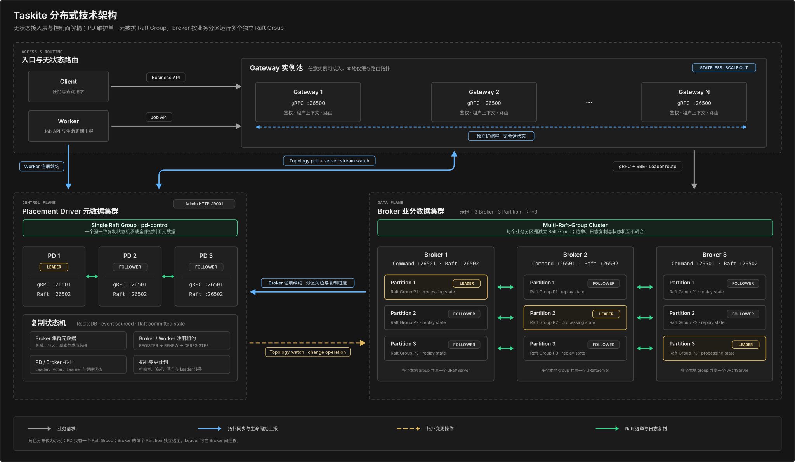

# Taskite

<p align="right"><a href="README.md">English</a> | <strong>简体中文</strong></p>


<h2 align="center">让任务可靠执行。</h2>

<p align="center">
  面向大规模持久化、容错任务执行的分布式任务调度引擎。
</p>

<p align="center">
  <a href="https://github.com/taskite-io/taskite">
    
  </a>
  <a href="LICENSE">
    
  </a>
  
  
</p>

Taskite 负责普通任务与定时任务的维护和管理，提供持久化任务执行、
Multi-Raft 复制、水平扩展、故障恢复和多租户路由能力。

- 网站：[taskite.io](https://taskite.io)
- 代码仓库：[github.com/taskite-io/taskite](https://github.com/taskite-io/taskite)
- Java 命名空间：`io.taskite`
- Maven Group：`io.taskite`
- 服务端构件：`io.taskite:taskite-distribution`
- 品牌指南：[taskite-brand.md](taskite/taskite-brand.md)

## 为什么选择 Taskite

- **普通任务与定时任务** - 通过 gRPC 直接创建任务，并使用显式到期时间、间隔和
  有限或无限执行次数管理可复用任务订阅。
- **多语言客户端模型** - 使用 Protocol Buffers 和 gRPC 支持的任意语言构建客户端和
  Worker。
- **消息驱动架构** - 将任务命令和事件写入只追加的复制日志，保留顺序并确保执行过程
  持久、可恢复。
- **水平扩展** - Broker 节点和分区可以独立扩展，在集群内分散处理负载，无需依赖外部
  关系型数据库即可处理大规模任务。
- **高可用与容错** - 在节点故障、Leader 切换和临时网络异常期间维持处理能力。

## 架构

Gateway 是无状态组件，可以水平扩展，并使用 Placement Driver 维护的拓扑进行请求路由。
Placement Driver 运行单个 Raft Group，保存 Broker 元数据、Broker/Worker 注册与租约以及
集群拓扑。Broker 构成数据面，每个业务分区都是独立的 Raft Group，拥有自己的 Leader 和
复制状态机。任务订阅经 Gateway → Placement Driver → Broker → partition 分发。
Placement Driver 保留订阅分发、镜像、ACK 与补分发机制，并负责定时触发；
Worker 通过注册租约激活和完成任务。



## 当前范围

Taskite 正在积极开发中，当前构建版本为 `0.1.0-SNAPSHOT`。

引擎支持任务生命周期管理、变量、Incident 和通过 API 创建的定时计划。
在首个稳定版本发布前，API 和存储兼容性可能继续演进。

## 快速开始

克隆代码仓库：

```bash
git clone https://github.com/taskite-io/taskite.git
cd taskite
```

### 构建

```bash
mvn clean verify
```

Java 全量回归在仓库根目录运行，包含 `dist` 中的并发迁移、滚动重启和配置集成测试：

```bash
mvn clean test -Dfrontend.tests.skip=true
```

该命令仅跳过 Console 前端测试，仍构建 Java HTTP 集成测试所需的页面资源。
不要用 `-pl` 或 `-Dtest` 缩小范围后将结果称为全量回归，也不要在同一源码目录同时运行
`clean` 和其他 Maven 构建。

Go 客户端和 `tkctl` 需要单独构建：

```bash
cd clients/go
go test ./...
go build -o bin/tkctl ./cmd/tkctl
```

SDK 和 CLI 使用方法见 [Go 客户端文档](docs/go-client.md)。

### 运行

```bash
java -jar dist/target/taskite-distribution-0.1.0-SNAPSHOT.jar \
  <broker|gateway|placement-driver> --key=value
```

本地集群启动和 Broker 扩容测试工具位于 [`scripts/`](scripts/)。

Broker 部署需要同时配置 `--port` 和 `--raft-port`。前者是供 Gateway 和 Placement Driver
访问的内部业务 gRPC API，后者用于 Broker 间的复制与选举。业务 API Server 不复用 Raft
端口，因为 Raft 拥有独立的连通性、负载、超时和访问控制要求。两个端口都必须显式配置，
Taskite 不会从其中一个推导另一个。Placement Driver 节点同样需要分别配置 `--grpc-port`
和 `--raft-port`。

完整的 Client、Gateway、Broker 和 Placement Driver 调用链路见
[网络端口与通信链路](docs/network-ports.zh-CN.md)。

## 监控

Prometheus 端点、完整指标名称、标签、计数语义和 Grafana 看板说明见
[Taskite 指标参考](docs/metrics.md)。

## 文档与社区

- [网站](https://taskite.io)
- [源代码](https://github.com/taskite-io/taskite)
- [网络端口与通信链路](docs/network-ports.zh-CN.md)
- [Raft 分区存储目录与快照恢复生命周期](docs/raft-storage-lifecycle.zh-CN.md)
- [指标](docs/metrics.md)
- [Go 客户端与 CLI](docs/go-client.md)
- [贡献指南](CONTRIBUTING.md)
- [行为准则](CODE_OF_CONDUCT.md)
- [问题跟踪](https://github.com/taskite-io/taskite/issues)

## 许可

Taskite 根据 [Taskite Community License 1.0](LICENSE) 以源码可用方式发布。该许可证允许
非商业目的的免费使用、修改和再分发。商业组织也可以在许可证约束下进行有限的内部、
非生产评估。

以下商业用途需要单独签署书面商业许可：

- 在营利性企业的内部生产活动中使用 Taskite；
- 将 Taskite 或其 API 作为托管或管理服务提供。

商业许可咨询：`lz19960321lz@gmail.com`。
常见场景见 [COMMERCIAL-LICENSING.md](COMMERCIAL-LICENSING.md)。

该许可证不是 OSI 批准的开源许可证。第三方组件适用各自的许可条款，详见
[THIRD_PARTY_NOTICES.md](THIRD_PARTY_NOTICES.md)。

使用 gRPC 工具根据 Taskite Gateway Protocol 生成代码，不会自动使生成的 Stub 受
Taskite Community License 约束。详见
[gRPC 代码生成许可说明](licenses/Clarification-on-gRPC-code-generation.txt)。

## 贡献

贡献活动适用 [CONTRIBUTING.md](CONTRIBUTING.md)，社区参与适用
[CODE_OF_CONDUCT.md](CODE_OF_CONDUCT.md)。
