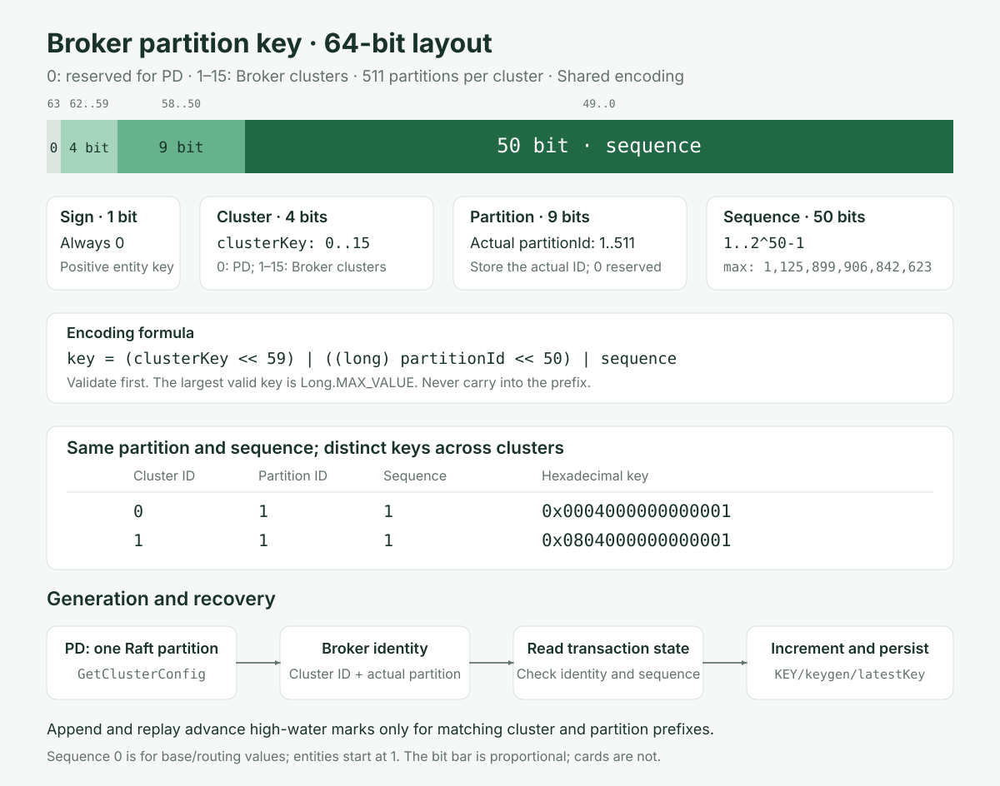

# Globally unique keys across clusters

[中文](broker-cluster-key-design.zh-CN.md) · [Key guide](assets/partition-key-guide.en.svg)

PD and Broker share one key encoding: **1 sign bit + 4 cluster bits + 9 partition bits + 50 sequence bits**. `clusterKey=0` is reserved for PD; PD assigns `1–15` to Broker clusters. Entity keys generated by PD and its Broker clusters occupy distinct namespaces.

## Layout and capacity



|    Field     | Bit positions | Bits |                          Meaning                           |
|--------------|---------------|------|------------------------------------------------------------|
| Sign         | 63            | 1    | Always 0; entity keys are positive `long` values           |
| `clusterKey` | 62–59         | 4    | 0 for PD; 1–15 for Broker clusters                         |
| Partition ID | 58–50         | 9    | Actual `partitionId` stored directly: 1–511; 0 is reserved |
| `sequence`   | 49–0          | 50   | Entity sequences increase from 1 to 1,125,899,906,842,623  |

Actual partition IDs are `1–511` in topology, membership changes and storage directories. A partition field of `0` indicates that no runtime partition prefix is present and is not assigned to a runtime partition. Sequence `0` serves as the generator baseline and an internal routing placeholder.

```java
key = (clusterKey << 59)
    | ((long) partitionId << 50)
    | sequence;
```

After range validation, the fields occupy disjoint bit ranges, so bitwise OR `|` and addition `+` produce the same result. Partition 1 contributes the offset `1L << 50`; PD's first entity key is `encodeKey(0, 1, 1) = 1125899906842625`.

`Protocol.MAXIMUM_CLUSTERS=16` includes the reserved PD namespace, leaving 15 Broker namespaces. `Protocol.MAXIMUM_PARTITIONS=511` limits the partition count per cluster. These are encoding capacity limits.

## Encoding and generation

`Protocol` exposes one set of methods for PD and Broker:

```java
long encodeKey(long clusterKey, int partitionId, long sequence);
long decodeClusterKey(long key);
int decodePartitionId(long key);
long decodeKeyInPartition(long key);
long encodeClusterKey(long clusterKey, long key);
long encodePartitionId(int partitionId, long key);
```

The last two methods replace the corresponding prefix and preserve the other fields. Encoding validates cluster, partition and sequence ranges; decoding rejects negative values.

Both use `PersistedKeyGenerator(clusterKey, partitionId, storage)`. PD supplies `Protocol.PLACEMENT_DRIVER_CLUSTER_KEY`; Broker supplies its cluster key obtained from PD.

The high-water mark resides in each partition's `KEY` column family under `keygen/latestKey`. If absent, the baseline is `encodeKey(clusterKey, partitionId, 0)` and the first generated sequence is 1. Every call reads the current transaction, validates the prefix, checks the sequence limit, then increments and persists the key in the same transaction. Exhaustion fails explicitly before carrying into the partition or cluster fields.

## Cluster allocation

The readable `clusterId` remains the identifier for configuration, registration and queries. `clusterKey` identifies a stable entity key namespace. PD's single Raft state machine allocates it.

|  Column family   |      Metadata key      |                     Content                      |
|------------------|------------------------|--------------------------------------------------|
| `PD_CLUSTER_IDS` | `clusterId`            | `DbLong(clusterKey)` for active cluster mappings |
| `KEY`            | `cluster-key/latestId` | Cluster allocation high-water mark               |

An absent allocation high-water mark means 0, the reserved PD key. The first Broker allocation is 1. Cluster allocation and entity generation use different metadata keys.

Creation follows this sequence:

1. `TopologyCreateClusterProcessor` validates configuration and capacity, then checks the cluster name.
2. An identical retry returns the existing key; conflicting configuration is rejected.
3. A new cluster receives the allocation high-water mark plus one in its `CLUSTER_CREATED` event.
4. `BrokerClusterCreatedApplier` persists the mapping, high-water mark and configuration in the state transaction.
5. The external API returns the creation result after commit confirmation.

Configuration updates, scaling, node restarts and leadership changes preserve the key. Deletion removes the active mapping while retaining the allocation high-water mark. Recreating a name allocates a new key. **A single allocation domain can allocate 15 Broker cluster namespaces in total.** Exhaustion returns `CLUSTER_LIMIT_EXCEEDED` before appending a creation event.

## Broker startup and management

Broker uses its configured `clusterId` and the existing `GetClusterConfig` RPC to obtain committed configuration and `clusterKey`:

```text
BrokerConfigurationStep
  → RegisterBroker
  → GetClusterConfig
  → BrokerClusterConfig
  → BrokerRuntime / BrokerPartitionManagerConfig
  → StreamPartitionDependencies / StreamProcessorContext
  → PersistedKeyGenerator
```

The response contains `optional int64 clusterKey = 6`. The client checks presence and the range `1–15`; Broker startup also checks the returned `clusterId`. The reserved key 0 cannot configure a Broker. Local Broker configuration does not override the key.

PD configuration queries, creation responses and cluster lists include `clusterKey`. Console shows it in the cluster list and detail view. Partition count validation uses `Protocol.MAXIMUM_PARTITIONS`. Worker registration, renewal and deregistration continue using the string `clusterId`.

## Routing and state recovery

Entity requests validate both cluster and partition prefixes. Internal requests without an entity key route through an explicit `partitionId` and construct the local `encodeKey(clusterKey, partitionId, 0)` placeholder. External references such as PD distribution keys retain their request semantics.

Event append and log replay both call `setKeyIfHigher(eventKey)`. The generator decodes the prefix: foreign cluster or partition keys do not advance its high-water mark; local keys raise it to `max(current, eventKey)`. A Broker ACK event whose record key is a PD `distributionKey` is therefore ignored automatically, without event origin classifications.

Repeated generation within one transaction sees earlier writes, and rollback also rolls back the high-water mark. Restart and snapshot installation read the persisted state; leadership must replay subsequent committed events before issuing keys. A persisted high-water mark with a negative value or a mismatched prefix fails explicitly.

Uniqueness depends on allocated cluster keys, partition IDs and persisted sequences under each prefix. Independent PD deployments have independent allocation domains. Lost or rolled-back allocation state cannot safely reissue keys in a namespace that still has existing entity data.

## Validation coverage

|                                       Scope                                       |                                                                                                                   Regression reference                                                                                                                   |
|-----------------------------------------------------------------------------------|----------------------------------------------------------------------------------------------------------------------------------------------------------------------------------------------------------------------------------------------------------|
| All 16×511 prefixes, encoding, decoding, boundaries and invalid input             | [ProtocolKeyTest](../protocol/src/test/java/io/taskite/protocol/ProtocolKeyTest.java)                                                                                                                                                                    |
| Reserved PD key, allocation transactions, restart and no reuse after deletion     | [BrokerClusterKeyStateTest](../placement-driver/src/test/java/io/taskite/placementdriver/state/BrokerClusterKeyStateTest.java)                                                                                                                           |
| Creation retries, conflicts, 15 Broker namespaces and partition boundaries        | [TopologyCreateClusterProcessorTest](../placement-driver/src/test/java/io/taskite/placementdriver/processing/broker/cluster/TopologyCreateClusterProcessorTest.java)                                                                                     |
| High-water marks, exhaustion, rollback and restart                                | [PersistedKeyGeneratorTest](../stream-platform/src/test/java/io/taskite/streamplatform/state/PersistedKeyGeneratorTest.java), [BrokerKeyTransactionTest](../stream-platform/src/test/java/io/taskite/streamplatform/state/BrokerKeyTransactionTest.java) |
| External PD ACK keys leave Broker high-water marks unchanged in append and replay | [ProcessingReplayEquivalenceTest](../stream-platform/src/test/java/io/taskite/streamplatform/processing/ProcessingReplayEquivalenceTest.java)                                                                                                            |
| Real PD and two Broker clusters generate distinct entity key prefixes             | [QueryJobEndToEndTest](../gateway/src/test/java/io/taskite/gateway/QueryJobEndToEndTest.java)                                                                                                                                                            |
| Console cluster list and detail display                                           | [Console E2E](../webapp/client/e2e/console.spec.ts)                                                                                                                                                                                                      |

