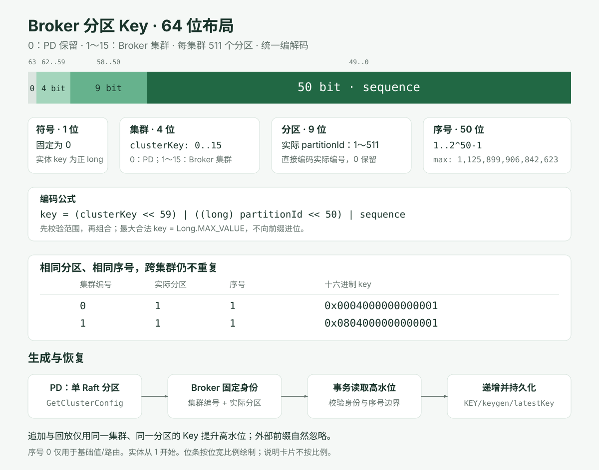

# 多集群全局唯一 Key

[English](broker-cluster-key-design.en.md) · [Key 使用说明](assets/partition-key-guide.zh-CN.svg)

PD 与 Broker 使用同一套 Key 编码：**1 位符号 + 4 位集群 + 9 位分区 + 50 位序号**。`clusterKey=0` 固定保留给 PD，PD 为 Broker 集群分配 `1～15`。同一套 PD 管理范围内，两者生成的实体 Key 互不重复。

## 位布局与容量



|      字段      |  位号   | 位数 |                含义                 |
|--------------|-------|----|-----------------------------------|
| 符号           | 63    | 1  | 固定为 0，实体 Key 为正 `long`            |
| `clusterKey` | 62～59 | 4  | 0 为 PD；1～15 为 Broker 集群           |
| 分区号          | 58～50 | 9  | 直接保存实际 `partitionId`：1～511；0 保留   |
| `sequence`   | 49～0  | 50 | 实体序号从 1 递增到 1,125,899,906,842,623 |

实际分区编号为 `1～511`，拓扑、成员变更与存储目录均使用实际编号。分区字段 `0` 表示没有运行时分区前缀，不分配给实际分区。序号 `0` 用于生成器基础值和内部路由占位值。

```java
key = (clusterKey << 59)
    | ((long) partitionId << 50)
    | sequence;
```

字段经过范围校验后占据互不重叠的位段，因此按位或 `|` 与加法 `+` 结果相同。分区 1 的偏移为 `1L << 50`，PD 的首个实体 Key 为 `encodeKey(0, 1, 1) = 1125899906842625`。

`Protocol.MAXIMUM_CLUSTERS=16` 包含 PD 保留的编号，因此最多分配 15 个 Broker 集群命名空间；`Protocol.MAXIMUM_PARTITIONS=511` 限制每集群的分区数量。这是编码容量上限。

## 编解码与生成

`Protocol` 提供统一接口，无需选择 PD 或 Broker 编码类型：

```java
long encodeKey(long clusterKey, int partitionId, long sequence);
long decodeClusterKey(long key);
int decodePartitionId(long key);
long decodeKeyInPartition(long key);
long encodeClusterKey(long clusterKey, long key);
long encodePartitionId(int partitionId, long key);
```

后两个方法替换已有 Key 的对应前缀，保留其他字段。编码时校验集群、分区和序号范围；解码时拒绝负数。

两者共用 `PersistedKeyGenerator(clusterKey, partitionId, storage)`。PD 传入 `Protocol.PLACEMENT_DRIVER_CLUSTER_KEY`，Broker 传入从 PD 获取的集群编号。

高水位保存在分区自己的 `KEY` 列簇中，键为 `keygen/latestKey`。缺失时以 `encodeKey(clusterKey, partitionId, 0)` 为基础值，首次生成序号 1。每次生成从当前事务读取完整 Key，校验前缀、检查序号上限，再递增并写入同一事务。序号耗尽时明确失败，防止向分区或集群字段进位。

## 集群编号分配

可读的 `clusterId` 继续用于配置、注册与查询，`clusterKey` 表示稳定的实体 Key 命名空间。PD 的单 Raft 状态机统一分配编号。

|        列簇        |          元数据键          |              内容               |
|------------------|------------------------|-------------------------------|
| `PD_CLUSTER_IDS` | `clusterId`            | `DbLong(clusterKey)`，保存活跃集群映射 |
| `KEY`            | `cluster-key/latestId` | 已分配集群编号的高水位                   |

编号高水位缺失时为 0，即 PD 保留编号；首次 Broker 分配得到 1。集群编号高水位与实体 Key 高水位使用不同元数据键。

创建流程：

1. `TopologyCreateClusterProcessor` 校验配置和容量，并检查同名集群。
2. 同名且配置相同的重试返回已有编号；配置冲突明确拒绝。
3. 新建集群使用高水位加一，将编号写入 `CLUSTER_CREATED` 事件。
4. `BrokerClusterCreatedApplier` 在状态事务中落地映射、高水位与配置。
5. 提交确认后，外部 API 返回明确创建结果。

配置更新、扩缩容、节点重启与 Leader 切换均保持编号不变。删除集群移除活跃映射，但保留分配高水位；同名重建分配新编号。**同一分配域累计最多分配 15 个 Broker 集群命名空间。** 容量耗尽时在创建事件写入前返回 `CLUSTER_LIMIT_EXCEEDED`。

## Broker 启动与管控

Broker 根据本地 `clusterId`，通过已有 `GetClusterConfig` RPC 获取已提交的配置与 `clusterKey`：

```text
BrokerConfigurationStep
  → RegisterBroker
  → GetClusterConfig
  → BrokerClusterConfig
  → BrokerRuntime / BrokerPartitionManagerConfig
  → StreamPartitionDependencies / StreamProcessorContext
  → PersistedKeyGenerator
```

响应使用 `optional int64 clusterKey = 6`。客户端检查字段存在性与 `1～15` 范围，Broker 启动还校验 `clusterId` 匹配。编号 0 为 PD 保留，不能作为 Broker 配置。Broker 本地配置不覆盖该编号。

PD 集群配置、创建响应及集群列表均返回 `clusterKey`，Console 集群列表和详情展示该编号。分区数量校验复用 `Protocol.MAXIMUM_PARTITIONS`。Worker 仍以字符串 `clusterId` 完成注册、续约和注销。

## 路由与状态恢复

实体请求同时校验目标集群和分区前缀。无实体 Key 的内部请求使用明确的 `partitionId` 路由，构造本地 `encodeKey(clusterKey, partitionId, 0)` 占位值。PD 分发编号等外部引用仍按对应请求语义处理。

追加事件与日志回放均调用 `setKeyIfHigher(eventKey)`。生成器通过统一解码判断归属：外部集群或分区的 Key 不推进本地高水位，本地 Key 将高水位提升为 `max(current, eventKey)`。因此，以 PD `distributionKey` 为 record key 的 Broker ACK 事件自然被忽略，无需额外的事件来源分类。

事务内多次生成可见之前的写入，回滚时高水位一起回滚。重启和快照安装后仍从状态读取高水位，完成后续已提交日志回放后才能开始 Leader 发号。持久化高水位的符号或前缀不匹配时明确失败。

Key 唯一性依赖集群编号、分区编号及各前缀下的持久化序号。多套独立 PD 各自具有独立分配域；丢失或回滚分配状态后，不能在仍存在旧实体数据的命名空间重新发号。

## 验证范围

|                范围                |                                                                                                                          回归依据                                                                                                                           |
|----------------------------------|---------------------------------------------------------------------------------------------------------------------------------------------------------------------------------------------------------------------------------------------------------|
| 全部 16×511 前缀、编解码、最大值和非法输入        | [ProtocolKeyTest](../protocol/src/test/java/io/taskite/protocol/ProtocolKeyTest.java)                                                                                                                                                                   |
| PD 编号保留、分配事务、重启与删除后不复用           | [BrokerClusterKeyStateTest](../placement-driver/src/test/java/io/taskite/placementdriver/state/BrokerClusterKeyStateTest.java)                                                                                                                          |
| 创建重试、配置冲突、15 个 Broker 上限及分区边界    | [TopologyCreateClusterProcessorTest](../placement-driver/src/test/java/io/taskite/placementdriver/processing/broker/cluster/TopologyCreateClusterProcessorTest.java)                                                                                    |
| 高水位、序号耗尽、事务回滚与重启                 | [PersistedKeyGeneratorTest](../stream-platform/src/test/java/io/taskite/streamplatform/state/PersistedKeyGeneratorTest.java)、[BrokerKeyTransactionTest](../stream-platform/src/test/java/io/taskite/streamplatform/state/BrokerKeyTransactionTest.java) |
| 外部 PD ACK 的追加与回放均不污染 Broker 高水位  | [ProcessingReplayEquivalenceTest](../stream-platform/src/test/java/io/taskite/streamplatform/processing/ProcessingReplayEquivalenceTest.java)                                                                                                           |
| 真实 PD 与两个 Broker 集群生成不同前缀的实体 Key | [QueryJobEndToEndTest](../gateway/src/test/java/io/taskite/gateway/QueryJobEndToEndTest.java)                                                                                                                                                           |
| Console 集群列表与详情展示                | [Console E2E](../webapp/client/e2e/console.spec.ts)                                                                                                                                                                                                     |

