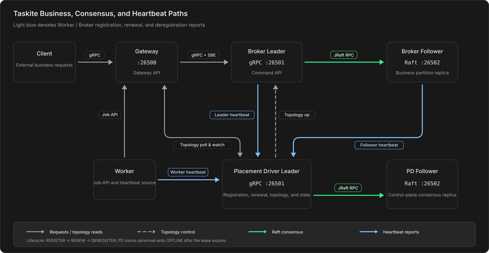

# Network Ports and Communication Paths

**English** | [简体中文](network-ports.zh-CN.md)

This document describes Taskite's default network ports and call relationships. Every port is
configurable. The values below are defaults for a single-node deployment or for hosts that run
only one instance of each component.

## Core Ports

| Default port |            Listener            |            Primary callers             |                    Protocol                    |                                                                      Responsibility                                                                       |
|--------------|--------------------------------|----------------------------------------|------------------------------------------------|-----------------------------------------------------------------------------------------------------------------------------------------------------------|
| `26500`      | Gateway                        | Client, Worker                         | gRPC                                           | Public business entry point. Accepts job and query requests, then applies authentication, tenant context, and routing before forwarding them to a Broker. |
| `26501`      | Broker                         | Gateway, Placement Driver              | gRPC with SBE-encoded payloads                 | Broker Command API. Handles business commands and partition-topology operations issued by PD.                                                             |
| `26502`      | Broker `JRaftServer`           | JRaft peers on other Brokers           | SOFA JRaft RPC over the current gRPC transport | Broker partition election, log replication, membership changes, and snapshot installation. All local partition groups share this port.                    |
| `19001`      | Placement Driver               | Operators and administration clients   | HTTP/JSON                                      | Cluster configuration, topology management, and operational APIs.                                                                                         |
| `26501`      | Placement Driver               | Gateway, Broker, Worker, PD seed peers | gRPC                                           | Control-plane API for topology queries and watches, Broker/Worker registration and renewal, management commands, and PD bootstrap discovery.              |
| `26502`      | Placement Driver `JRaftServer` | JRaft peers on other PD nodes          | SOFA JRaft RPC over the current gRPC transport | PD state-machine election, log replication, membership changes, and snapshot installation.                                                                |

Broker and Placement Driver both use `26501` by default for their business or control-plane gRPC
API and `26502` for their independent JRaft RPC server. These defaults assume the components run
on different hosts. When multiple processes share a host, every process must be configured with
non-conflicting ports.

## Communication Topology

Gateway periodically calls `GetBrokerTopology` through Placement Driver port `26501` and also
listens for changes through the `WatchBrokerTopology` server-streaming RPC. The diagram uses a
bidirectional solid line for topology reads and synchronization. Dashed lines only represent
partition-topology operations sent from Placement Driver to Broker.

## Network Access Policy

For production deployments, configure firewalls or security groups according to the call paths:

- `26500`: allow access from Client and Worker networks.
- Broker `26501`: allow access only from Gateway, Placement Driver, and controlled internal
  components.
- Broker `26502`: allow access only between Broker nodes in the same Broker cluster.
- `19001`: allow access only from the operations and administration network.
- Placement Driver `26501`: allow access from Gateway, Broker, Worker, and PD seed peers.
- Placement Driver `26502`: allow access only between PD nodes in the same PD cluster.

Business and Raft ports must be configured explicitly and must not be equal. Every instance on a
shared host needs a unique listening port. Container, NAT, and load-balancer deployments must also
ensure that every advertised endpoint registered in topology is directly reachable by its callers.

## Configuration

- Gateway: `taskite.gateway.network.port`, environment variable `TASKITE_GATEWAY_NETWORK_PORT`.
- Broker Command API: `taskite.broker.network.command-port`, environment variable `TASKITE_BROKER_NETWORK_COMMAND_PORT`.
- Broker Raft: `taskite.broker.network.raft-port`, environment variable `TASKITE_BROKER_NETWORK_RAFT_PORT`.
- PD HTTP: `server.port`, environment variable `SERVER_PORT`.
- PD gRPC: `taskite.pd.network.grpc-port`, environment variable `TASKITE_PD_NETWORK_GRPC_PORT`.
- PD Raft: `taskite.pd.network.raft-port`, environment variable `TASKITE_PD_NETWORK_RAFT_PORT`.
- PD bootstrap peers: `taskite.pd.consensus.bootstrap-peers`,
  environment variable `TASKITE_PD_CONSENSUS_BOOTSTRAP_PEERS`, format `nodeId@host:grpcPort:raftPort`.

Local cluster launchers use PD gRPC/Raft pairs `26501/26502`, `26503/26504`, `26505/26506`;
Broker command/Raft pairs `26511/26512`, `26513/26514`, `26515/26516`;
PD HTTP `19001–19003`, Broker management `9600–9602`, and Gateway `26500`.
Runtime overrides use complete `--taskite.<component>.*=value` arguments or `TASKITE_*`
environment names. See [configuration migration](configuration-hierarchy-audit.zh-CN.md)
for launcher settings and precedence.
