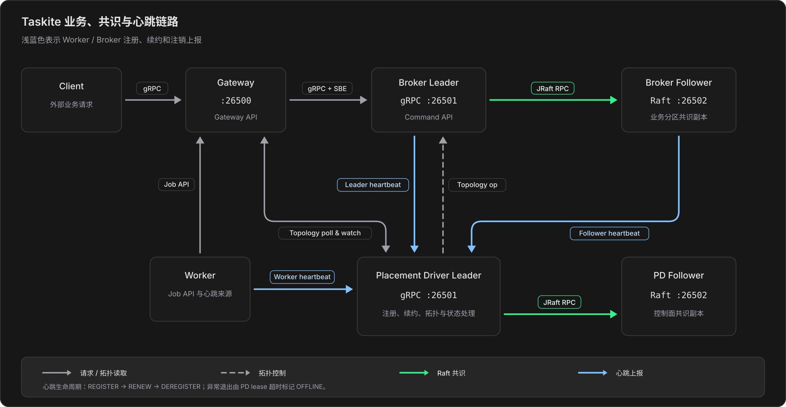

# 网络端口与通信链路

[English](network-ports.md) | **简体中文**

本文说明 Taskite 默认网络端口和调用关系。所有端口均可配置；表中的数值是单节点或每台主机仅运行一个对应实例时的默认值。

## 核心端口

|  默认端口   |              监听组件              |               主要调用方                |                 协议                 |                        职责                         |
|---------|--------------------------------|------------------------------------|------------------------------------|---------------------------------------------------|
| `26500` | Gateway                        | Client、Worker                      | gRPC                               | 对外业务入口。接收任务和查询请求，完成鉴权、租户上下文与路由后转发到 Broker。        |
| `26501` | Broker                         | Gateway、Placement Driver           | gRPC，载荷使用 SBE 编码                   | Broker Command API。处理业务命令以及 PD 下发的分区拓扑变更。         |
| `26502` | Broker `JRaftServer`           | 其他 Broker 的 JRaft peer             | SOFA JRaft RPC，当前使用 gRPC transport | Broker 分区的选举、日志复制、成员变更和快照安装。所有本地分区 group 共享该端口。   |
| `19001` | Placement Driver               | 运维或管理端                             | HTTP/JSON                          | 集群配置、拓扑管理和运维 API。                                 |
| `26501` | Placement Driver               | Gateway、Broker、Worker、PD seed peer | gRPC                               | 控制面 API：拓扑查询与监听、Broker/Worker 注册续约、管理命令和 PD 启动发现。 |
| `26502` | Placement Driver `JRaftServer` | 其他 PD 的 JRaft peer                 | SOFA JRaft RPC，当前使用 gRPC transport | PD 状态机的选举、日志复制、成员变更和快照安装。                         |

Broker 与 Placement Driver 默认都使用 `26501` 作为业务或控制面 gRPC 端口，使用 `26502` 作为各自独立的 JRaft RPC 端口。该默认值适用于组件部署在不同主机的场景；同机部署时必须为每个进程显式配置互不冲突的端口。

## 通信拓扑

Gateway 通过 Placement Driver 的 `26501` 端口同时周期调用 `GetBrokerTopology` 拉取拓扑，并通过 `WatchBrokerTopology` 的 server-streaming RPC 监听变化。图中以双向实线表示这条拓扑读取与同步链路；虚线仅表示 Placement Driver 向 Broker 下发分区拓扑变更操作。

## 网络访问策略

生产环境建议按调用关系配置防火墙或安全组：

- `26500`：对 Client 和 Worker 所在网络开放。
- Broker `26501`：仅对 Gateway、Placement Driver 和受控内部组件开放。
- Broker `26502`：仅允许同一 Broker 集群的 Broker 节点互访。
- `19001`：仅对运维管理网络开放。
- Placement Driver `26501`：允许 Gateway、Broker、Worker 和 PD seed peer 访问。
- Placement Driver `26502`：仅允许同一 PD 集群的 PD 节点互访。

业务端口与 Raft 端口必须显式配置且不能相同。多实例部署在同一主机时，每个实例都需要唯一的监听端口；容器、NAT 和负载均衡场景还必须保证注册到拓扑中的 advertised endpoint 能被对应调用方直接访问。

## 配置位置

- Gateway：`taskite.gateway.network.port`，环境变量 `TASKITE_GATEWAY_NETWORK_PORT`。
- Broker Command API：`taskite.broker.network.command-port`，环境变量 `TASKITE_BROKER_NETWORK_COMMAND_PORT`。
- Broker Raft：`taskite.broker.network.raft-port`，环境变量 `TASKITE_BROKER_NETWORK_RAFT_PORT`。
- PD HTTP：`server.port`，环境变量 `SERVER_PORT`。
- PD gRPC：`taskite.pd.network.grpc-port`，环境变量 `TASKITE_PD_NETWORK_GRPC_PORT`。
- PD Raft：`taskite.pd.network.raft-port`，环境变量 `TASKITE_PD_NETWORK_RAFT_PORT`。
- PD bootstrap peers：`taskite.pd.consensus.bootstrap-peers`，
  环境变量 `TASKITE_PD_CONSENSUS_BOOTSTRAP_PEERS`，格式 `nodeId@host:grpcPort:raftPort`。

同机集群脚本使用 PD gRPC/Raft `26501/26502`、`26503/26504`、`26505/26506`；
Broker command/Raft `26511/26512`、`26513/26514`、`26515/26516`；
PD HTTP `19001–19003`、Broker management `9600–9602`，Gateway `26500`。
配置使用完整 `--taskite.<component>.*=value` 参数或 `TASKITE_*` 环境变量；
启动器配置与覆盖规则见[配置迁移清单](configuration-hierarchy-audit.zh-CN.md)。

## IPv6 地址

`host` 字段使用裸地址，例如 `2001:db8::10`；与端口组合时使用方括号，例如
`[2001:db8::10]:26501`。PD peer 配置采用
`meta-1@[2001:db8::11]:26501:26502`，HTTP URL 采用
`http://[2001:db8::10]:19001`。IPv4 和 DNS 名称保持 `host:port` 格式。

仓库的节点启动脚本支持上述格式。Raft RPC、PeerId 与持久化配置使用一致的 IPv6
端点编码；PD Leader 重定向和拓扑地址也使用方括号。部署时应让所有调用方都能访问
所注册的地址，并显式配置监听地址；`0.0.0.0` 是否同时接受 IPv6 取决于操作系统和 JVM，
纯 IPv6 部署可指定 `::` 或本机 IPv6 地址。
