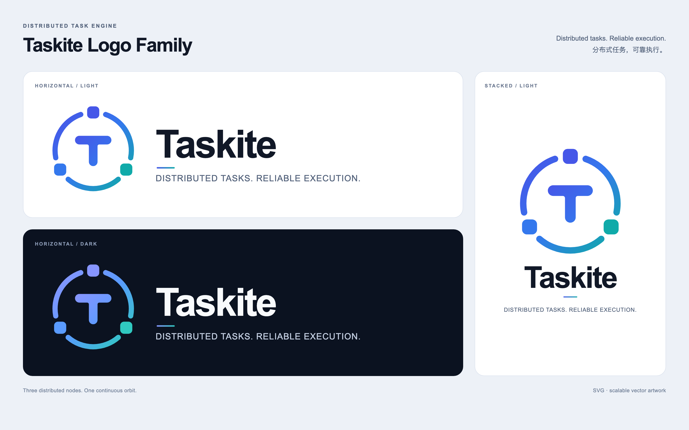
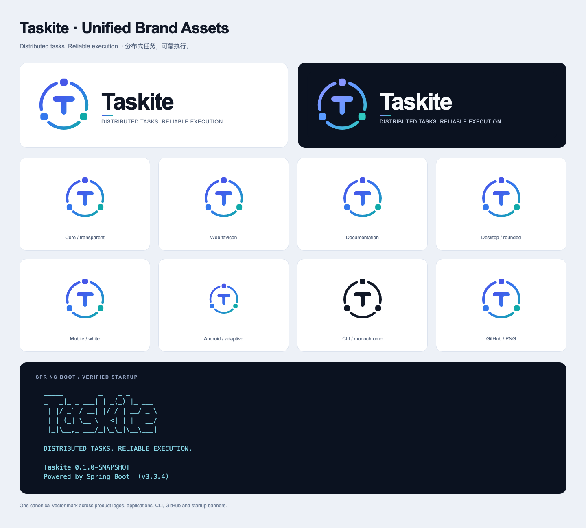

# Taskite 品牌资产

Taskite 的产品 Logo、应用图标和 CLI 标识统一使用三节点环形 T 图案。Spring Boot Banner 使用 Taskite ASCII 字标。

> **Distributed tasks. Reliable execution.**
>
> **分布式任务，可靠执行。**

母版：[taskite-icon.svg](taskite-icon.svg)。网站：[taskite.io](https://taskite.io)。仓库：[taskite-io/taskite](https://github.com/taskite-io/taskite)。

## 产品 Logo

|  版本  |                        文件                         |     画布     |  背景  |
|------|---------------------------------------------------|------------|------|
| 浅色横版 | [horizontal-light.svg](logo/horizontal-light.svg) | 1200 × 320 | 透明   |
| 深色横版 | [horizontal-dark.svg](logo/horizontal-dark.svg)   | 1200 × 320 | 深色底板 |
| 浅色竖版 | [stacked-light.svg](logo/stacked-light.svg)       | 640 × 760  | 透明   |

默认 [logo.svg](logo.svg) 与浅色横版相同。深色版本提高蓝青色图案的亮度，以适配深色背景。所有版本使用相同的 Taskite 字标和 Slogan。

## 应用与技术场景图标

|      用途       |                               文件                                |    默认尺寸     |       处理方式        |
|---------------|-----------------------------------------------------------------|-------------|-------------------|
| 核心图标          | [taskite-icon.svg](icon/core/taskite-icon.svg)                  | 320 × 320   | 透明背景              |
| 文档图标          | [icon.svg](icon/docs/icon.svg)                                  | 256 × 256   | 透明背景              |
| Web Favicon   | [favicon.svg](icon/web/favicon.svg)                             | 64 × 64     | 透明背景              |
| 桌面应用          | [app-icon.svg](icon/desktop/app-icon.svg)                       | 512 × 512   | 白色圆角底板            |
| 移动应用          | [app-icon.svg](icon/mobile/app-icon.svg)                        | 1024 × 1024 | 白色方形底板            |
| Android 自适应前景 | [adaptive-foreground.svg](icon/android/adaptive-foreground.svg) | 1080 × 1080 | 图案居中缩放至 75%       |
| Android 自适应背景 | [adaptive-background.svg](icon/android/adaptive-background.svg) | 1080 × 1080 | 白色底板              |
| CLI 单色图标      | [cli-monochrome.svg](icon/terminal/cli-monochrome.svg)          | 128 × 128   | 使用 `currentColor` |
| GitHub 组织头像   | [github-organization.png](icon/web/github-organization.png)     | 512 × 512   | 白色背景 PNG          |

这些版本共享母版中的三段环形轨道、三个圆角节点和中央 T 的路径。平台适配只调整尺寸、留白、背景和颜色。

## Spring Boot Banner

品牌资源：[spring-boot-banner.txt](icon/terminal/spring-boot-banner.txt)。

发行包使用仓库中的 `dist/src/main/resources/banner.txt`，内容与品牌资源保持一致。Banner 包含 Taskite ASCII 字标、产品 Slogan 和版本信息。

项目版本通过 Maven 资源过滤填入 `@project.version@`；Spring Boot 在启动时解析 `${spring-boot.formatted-version}`。复制这份 Banner 到其他 Maven 项目时，应为 `banner.txt` 启用 `@...@` 资源过滤。

Spring Boot 通过 `AnsiColor` 和 `AnsiStyle` 控制终端颜色。可使用 `--spring.main.banner-mode=console` 显示，或使用 `--spring.main.banner-mode=off` 关闭。

## 品牌色与使用规则

|  用途   |    色值     |
|-------|-----------|
| 主蓝色   | `#4657E8` |
| 轨道蓝色  | `#3478ED` |
| 青绿色节点 | `#10AAA9` |
| 字标深色  | `#111827` |
| 深色背景  | `#0B1220` |

- 保持图形等比例缩放，不压缩、拉伸或旋转。
- 保留三个节点和环形轨道之间的间隔。
- 深色背景使用深色 Logo；终端与单色技术场景使用 `currentColor` 版本。
- Android 自适应图标和 PWA 可遮罩图标保留各自的安全留白。
- 需要原生应用或浏览器栅格资源时，从对应平台的矢量设计源文件导出。

尺寸清单见 [icon-sizes.json](icon-sizes.json)，Slogan 候选见 [logo/README.md](logo/README.md)。

