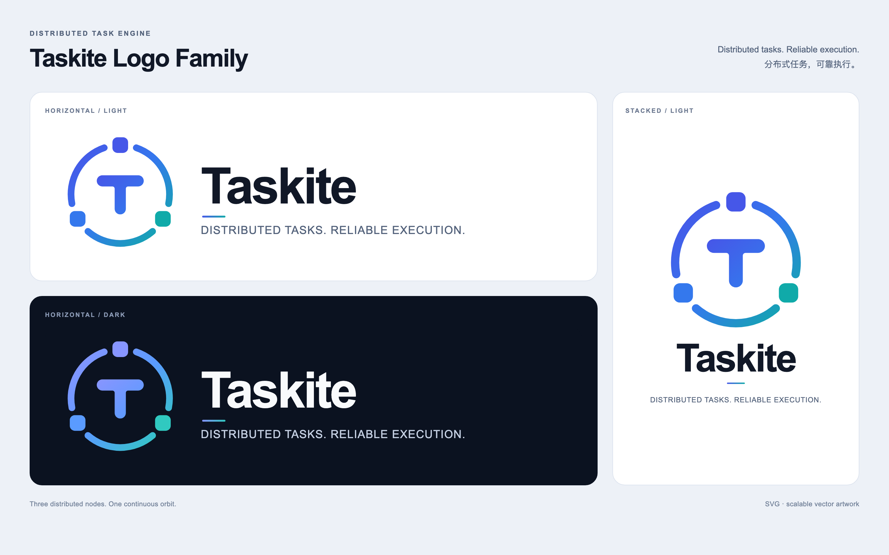

# Taskite Logo 与 Slogan

Taskite 是面向普通任务与定时任务的分布式任务调度引擎。品牌表达围绕任务分发、水平扩展、持久化状态和故障恢复。

当前采用：

> **Distributed tasks. Reliable execution.**
>
> **分布式任务，可靠执行。**

这句话直接表达产品类别与核心价值，适合代码仓库、产品首页和开发者文档。

## Slogan 候选

|                     英文                     |       中文        |      表达重点      |
|--------------------------------------------|-----------------|----------------|
| **Distributed tasks. Reliable execution.** | **分布式任务，可靠执行。** | 当前采用；产品定位与可靠性  |
| Reliable tasks. At any scale.              | 任意规模，可靠执行。      | 大规模任务与水平扩展     |
| Tasks that keep moving.                    | 让任务持续向前。        | 持久化、重试与故障恢复    |
| Distribute the work. Simplify execution.   | 分散负载，简化执行。      | 分布式内核与开发者体验    |
| Schedule. Distribute. Execute.             | 调度、分发、执行。       | 普通任务与定时任务的执行链路 |

## 图标与文件

Logo 复用 `../taskite-icon.svg` 的矢量路径，与 Console 中的 Taskite 图标一致。环形轨道连接三个节点，表达任务分发、周期调度和故障后的持续执行；中央 T 对应 Taskite。

|  版本  |                      文件                      |     画布     |  背景  |
|------|----------------------------------------------|------------|------|
| 浅色横版 | [horizontal-light.svg](horizontal-light.svg) | 1200 × 320 | 透明   |
| 深色横版 | [horizontal-dark.svg](horizontal-dark.svg)   | 1200 × 320 | 深色底板 |
| 浅色竖版 | [stacked-light.svg](stacked-light.svg)       | 640 × 760  | 透明   |

三个文件均为 SVG 矢量图，没有位图或外部资源依赖。深色版本提高蓝青色标识的亮度，适配深色背景。

